# ExperimentLab

**A/B-тесты: статистический вывод, последовательный анализ и корректировка с машинным обучением.**

В этом проекте я исследую, когда результату эксперимента можно доверять. Я реализовал Python-пакет для расчёта эффектов, доверительных интервалов и мощности, а затем проверил его на повторяющихся экспериментах с известным истинным эффектом.

Главные вопросы: сохраняется ли заявленный уровень ошибки, как часто интервалы покрывают истинный эффект и что меняется при подглядывании в результаты, множественных сравнениях, кластеризации и корректировке по исходным признакам. В отдельном исследовании я сравниваю обычную разность средних, регрессию и cross-fitting с машинным обучением.

**Python · NumPy · SciPy · pandas · scikit-learn · Matplotlib · pytest · statsmodels**

Команды воспроизведения используют окружение из раздела [«Запуск»](#запуск).

Все данные исследования **синтетические**. Проект демонстрирует свойства методов, а не результаты эксперимента конкретной компании. Для пользовательского CSV предусмотрен отдельный CLI.

[Результаты](#результаты) · [Регрессия и ML](#регрессионная-корректировка-и-cross-fitting) · [Методика](#методика) · [Структура](#структура) · [Запуск](#запуск) · [Проверки](#проверки) · [Ограничения](#ограничения) · [Источники](#источники)

| Исследовательский блок | Содержание |
|---|---|
| Базовый статистический вывод | Welch, конверсия, мощность, MDE, bootstrap, перестановочные тесты |
| Риски экспериментального анализа | Подглядывание, Holm/Bonferroni, CUPED, кластеризация |
| Сложные метрики и интервалы | Delta method для отношений сумм, BCa и jackknife |
| Последовательный вывод | Экспоненциальный супермартингал, normal-mixture e-process, confidence sequence |
| Регрессия и машинное обучение | OLS через SVD, HC3, взаимодействия, cross-fitted AIPW, Ridge, Random Forest |
| Проверка оценивателей | Смещение, RMSE, эмпирическая дисперсия, покрытие, парное сравнение MSE |

## Результаты

Полный прогон: seed **1805**, α = **0,05**, по **2 000 независимых повторений** основных сценариев. Для более дорогих bootstrap/permutation-сценариев — **500 повторений**, по **999 повторных выборок** внутри каждого эксперимента. Параметры сохранены в [configs/full.json](configs/full.json).

### 1. Подглядывание увеличивает риск ложного вывода

A/A-эксперимент: истинный эффект равен нулю, нормальные независимые наблюдения, максимум 500 пользователей в каждой группе. Промежуточные проверки выполняются после 50, 100, …, 500 пользователей на группу.

| Процедура | Частота хотя бы одного ложного срабатывания | 95% интервал Monte Carlo |
|---|---:|---:|
| Одна проверка в конце | 5,00% | 4,13–6,04% |
| Остановка при первом p < 0,05 | 20,50% | 18,79–22,33% |
| Bonferroni на 10 заранее заданных проверок | 2,70% | 2,08–3,51% |

Порог 0,05 на каждом просмотре не обеспечивает общий уровень ошибки 5%. Bonferroni контролирует риск, но в этом сценарии консервативен. Это не реализация оптимального последовательного теста.

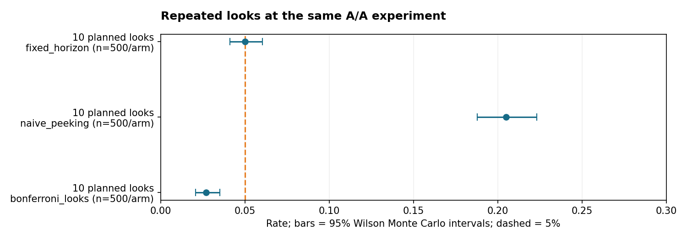

### 2. При множестве метрик важна ошибка на уровне семейства

Для 20 независимых нулевых z-статистик вероятность хотя бы одного ложного открытия без поправки составила **65,65%**; с Holm и Bonferroni — **5,40%** (95% ДИ **4,49–6,48%**).

Теоретическая вероятность без поправки: $1-(1-0.05)^{20} \approx 64.15\%$. Расхождение с симуляцией совместимо с её погрешностью. Совпадение Holm и Bonferroni по FWER при глобальной нулевой гипотезе ожидаемо: событие «хотя бы одно отклонение» определяется одним и тем же первым порогом. Число дальнейших отклонений может различаться.

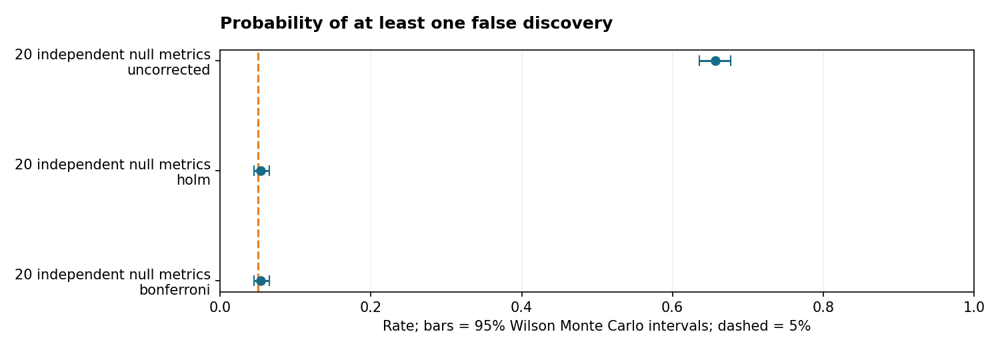

### 3. CUPED помогает при информативном историческом показателе

200 пользователей на группу, истинный эффект 0,2 стандартного отклонения исходной метрики. Коэффициент обучается на **отдельных 10 000 исторических наблюдениях** и фиксируется до экспериментов.

| Корреляция X и Y | Мощность без CUPED | Мощность с CUPED |
|---|---:|---:|
| 0 | 51,85% | 51,85% |
| 0,4 | 51,55% | 60,45% |
| 0,8 | 52,20% | 90,75% |

При ρ = 0,8 интервал Monte Carlo для мощности с CUPED — **89,40–91,94%**. При нулевом эффекте частота ложных срабатываний CUPED в этом сценарии составляет **5,00%** (4,13–6,04%). При неинформативном X выигрыша нет.

Это результат конкретной линейной модели с устойчивой исторической связью, не универсальная гарантия роста мощности. Интервалы всех сценариев и диагностика дисперсии находятся в [rates.csv](reports/rates.csv) и [cuped_diagnostics.csv](reports/cuped_diagnostics.csv).

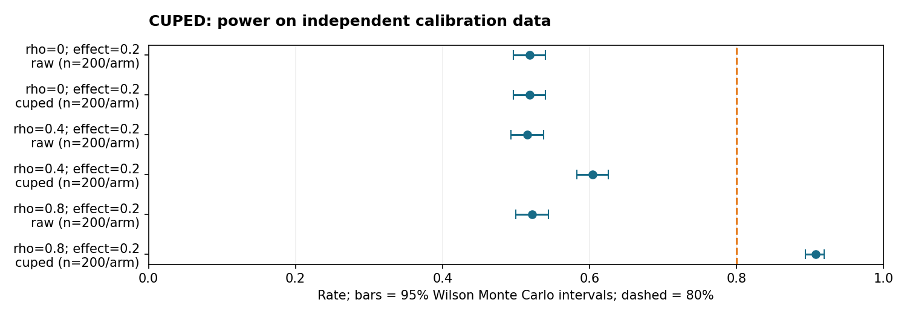

### 4. Размер выборки нужно планировать до запуска

При α = 0,05, мощности 80% и распределении пользователей 1:1:

| Задача | Пользователей на группу |
|---|---:|
| Различить средние на 0,2 стандартного отклонения | 394 |
| Обнаружить рост конверсии с 10% до 12% | 3 841 |

При 5 000 пользователей на группу и базовой конверсии 10% положительный MDE составляет примерно **1,744 процентного пункта**. Рост с 10% до 12% — это +2 п.п., или +20% относительно исходного уровня.

Планирование средних использует модель равных дисперсий и нецентральное t-распределение; для последующего Welch это приближение. Планирование конверсии использует нормальную аппроксимацию. Размеры — число независимых пользователей, а не событий или сессий.

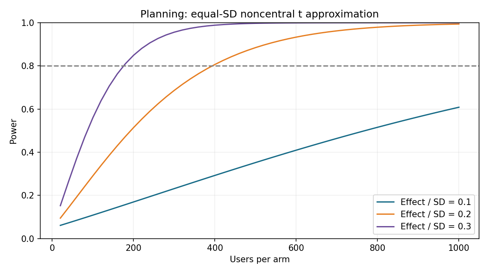

### 5. Название метода не гарантирует точного покрытия

При нулевом эффекте и n = 200 на группу Welch дал частоты ложных срабатываний от **3,85% до 4,65%** в четырёх непрерывных моделях. Для логнормального сценария результат оказался консервативным; универсальный вывод о всех асимметричных данных из этого не следует.

В отдельной серии с n = 100 на группу percentile bootstrap показал покрытие **93,2%** при нулевом эффекте для нормальной и логнормальной моделей. Интервал Monte Carlo — **90,65–95,09%**. Этот прогон не позволяет уверенно отличить такое покрытие от 95%, но показывает, зачем его проверять. Bootstrap здесь не BCa и не bootstrap-t.

Welch, bootstrap и permutation в серии `resampling` применяются к одним и тем же данным. В основной серии `fixed_horizon` размер выборки другой; смешивать эти серии для сравнения методов нельзя.

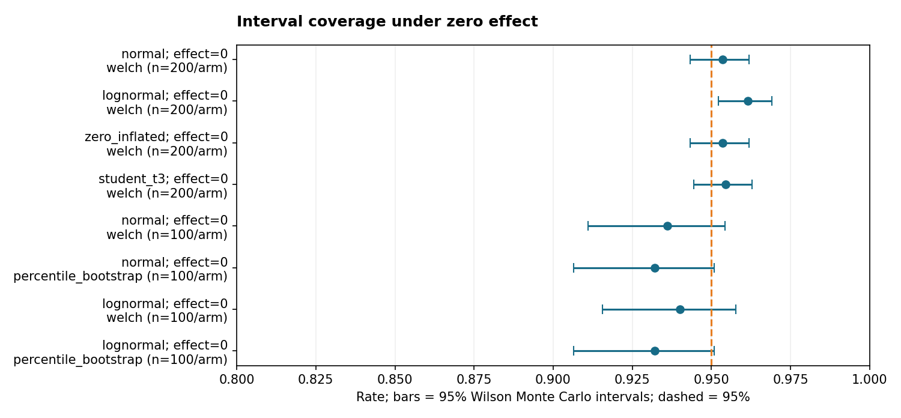

## Расширенное исследование: зависимость и сложные метрики

Новые сценарии используют отдельный seed **650**: 2 000 повторений для кластеров и ratio-метрик, 500 для сравнения bootstrap-интервалов, по 1 999 пересэмплирований. Результаты: [rates.csv](reports/robustness/rates.csv). Эти сценарии не меняют результаты базового исследования.

### Кластерная рандомизация

Если вариант назначается магазину, школе или организации, наблюдения внутри одного кластера не независимы. В модели используются 40 кластеров на группу, по 20 наблюдений в каждом, с одинаковой внутрикластерной корреляцией ICC. Истинный эффект равен нулю.

| ICC | Welch по отдельным строкам | Welch по средним кластеров |
|---|---:|---:|
| 0 | 4,35% | 4,15% |
| 0,1 | 25,30% | 5,40% |
| 0,3 | 45,65% | 4,90% |

При ICC = 0,3 правильная единица анализа возвращает частоту ложных срабатываний к 4,90% (95% ДИ 4,04–5,94%), тогда как игнорирование зависимости даёт 45,65% (43,48–47,84%). Для одинаковых размеров кластеров дизайн-эффект составляет:

$$DE=1+(m-1)\rho.$$

При m = 20 и ICC = 0,3 это 6,7. Такое соотношение относится к дисперсии среднего в данной обменной модели, а не является универсальным множителем размера выборки.

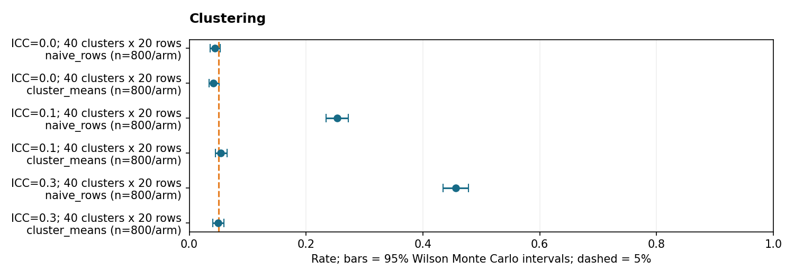

`cluster_welch` агрегирует наблюдения до средних независимых кластеров и применяет Welch. **Целевая величина — эффект для среднего кластера с равными весами.** При неодинаковых размерах это не эффект для среднего пользователя. В API поля `n_control` и `n_treatment` считают кластеры; на исследовательском графике n=800 означает исходные строки, а число кластеров указано в подписи сценария. При числе кластеров меньше 20 на группу выдаётся предупреждение. Это не общий регрессионный sandwich-оцениватель и не решение задачи перекрёстных кластеров.

### Ratio-метрики: отношение сумм

Выручка на сессию или клики на показ могут рассчитываться как отношение сумм. Для независимых пользователей:

$$\widehat R=\frac{\bar X}{\bar Y},\qquad Z_i=\frac{X_i-\widehat RY_i}{\bar Y},\qquad \widehat{Var}(\widehat R)=\frac{s_Z^2}{n}.$$

Такое представление учитывает ковариацию числителя и знаменателя внутри пользователя. Для двух независимых групп дисперсии складываются; строится нормальный delta-интервал разности отношений. При нестабильном или близком к нулю знаменателе аппроксимация может быть ненадёжной; отдельный Fieller-модуль ниже оценивает одно отношение, а не разность отношений.

**Отношение сумм не равно среднему индивидуальных отношений.** Например, для X=(1,9), Y=(1,3) отношение сумм равно 2,5, а среднее X/Y — 2. Это разные целевые величины.

В симуляции у пользователя 1+Poisson(4) возможностей, а индивидуальная интенсивность умножена на LogNormal(−0,32; 0,8). Средний множитель равен 1. Числитель условно пуассоновский; безусловно присутствует пользовательская неоднородность. По 300 пользователей на группу, истинные отношения 2 и 2 либо 2 и 2,3.

| Метод при нулевом эффекте | Ложные срабатывания | Покрытие 95%-го интервала |
|---|---:|---:|
| Delta method на уровне пользователей | 5,75% | 94,25% |
| Наивная пуассоновская дисперсия по суммам | 56,35% | 43,65% |

95% ДИ для ошибки delta-метода — 4,81–6,86%. Наивная процедура намеренно использует неверную модель дисперсии при гетерогенности: её высокую частоту отклонений под альтернативой нельзя интерпретировать как преимущество в мощности без учёта нарушенного уровня ошибки.

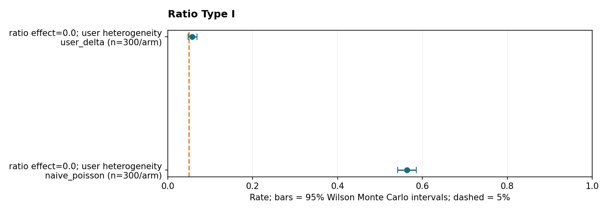

### BCa не означает автоматического превосходства

Добавлен BCa-интервал SciPy: поправка на смещение bootstrap-распределения и ускорение, оцениваемое через jackknife. Он сравнивается с Welch и percentile на одних выборках по 80 наблюдений в каждой группе, при нулевом эффекте.

| Распределение | Welch: покрытие | Percentile | BCa |
|---|---:|---:|---:|
| Нормальное | 94,6% | 94,2% | 93,2% |
| Логнормальное | 95,2% | 92,8% | 91,0% |

В логнормальном сценарии BCa показал **91,0%** покрытия (88,17–93,21%). Поэтому в проекте нет правила «всегда выбирать более сложный bootstrap». Это конечновыборочный результат для выбранной модели, размера и числа пересэмплирований. Сравнение разностей покрытий требует учёта парности методов; отдельного теста их превосходства здесь нет. При вырожденной выборке BCa возвращает явную ошибку вместо скрытого переключения на другой метод.

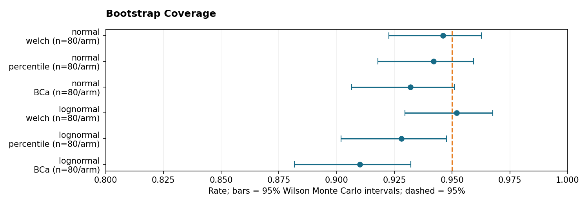

### Как выбрать интерфейс

| Данные и цель | Интерфейс | Единица независимости |
|---|---|---|
| Среднее непрерывной метрики | `welch`, `bootstrap_mean`, `bca_mean` | Пользователь |
| Разность конверсий | `conversion` | Пользователь |
| Разность отношений сумм | `ratio_delta` | Пользователь с парой числитель/знаменатель |
| Средний результат кластера | `cluster_welch` | Кластер |

Новые модули: `ratio.py`, `clusters.py`, `advanced_resampling.py`, `advanced.py` (CLI), `robustness.py` (исследование). Проверки — `tests/test_advanced.py`.
## Последовательный анализ: e-process и confidence sequence

В этом блоке я вывожу и проверяю процедуру, для которой контроль ошибки сохраняется при многократном просмотре данных. Это отдельная модель с **известной дисперсией**, а не универсальное расширение обычного t-теста.

Пусть $D_i=T_i-C_i$ — независимые разности наблюдений двух групп, $E[D_i]=\theta$, а условная производящая функция удовлетворяет

$$E[\exp(\lambda(D_i-\theta))\mid\mathcal F_{i-1}]\leq\exp(\lambda^2\sigma^2/2).$$

В симуляции разности нормальны и $\sigma^2=2$. Заменять эту известную границу выборочной дисперсией нельзя: приведённое доказательство тогда перестаёт работать. Произвольное сопоставление независимых наблюдений двух групп допустимо только без выбора пар по исходам; это не дизайн с естественно парными участниками.

### От экспоненциального мартингала к e-process

Обозначим $S_t(\theta)=\sum_{i=1}^t(D_i-\theta)$ и $V_t=t\sigma^2$. Для фиксированного λ:

$$M_t(\lambda,\theta)=\exp\{\lambda S_t(\theta)-\lambda^2V_t/2\}.$$

Условное ожидание множителя нового наблюдения не больше единицы. Поэтому $M_t$ — неотрицательный супермартингал с начальным значением 1 (мартингал в точной нормальной модели).

Интегрируя по заранее выбранной смеси $\lambda\sim N(0,\tau^2)$ и дополняя квадрат в экспоненте, получаем:

$$E_t(\theta)=\frac{1}{\sqrt{1+\tau^2V_t}}\exp\left\{\frac{\tau^2S_t(\theta)^2}{2(1+\tau^2V_t)}\right\}.$$

По неравенству Вилля:

$$P_\theta\left(\sup_{t\geq1}E_t(\theta)\geq1/\alpha\right)\leq\alpha.$$

Значит, H₀ можно отклонить при первом пересечении порога $1/\alpha$. В коде сравниваются логарифмы, чтобы избежать переполнения экспоненты. Масштаб смеси τ задаётся до наблюдения данных; в исследовании τ=0,2. Его подбор по результату без дополнительной корректировки не разрешён этим доказательством. E-value не является вероятностью истинности H₀.

### Доверительная последовательность

Обращение неравенства $E_t(\theta)<1/\alpha$ даёт интервалы с центром $\bar D_t$ и радиусом

$$r_t=\frac1t\sqrt{\frac{1+\tau^2V_t}{\tau^2}\left[2\log(1/\alpha)+\log(1+\tau^2V_t)\right]}.$$

Для всей последовательности одновременно выполняется $P_\theta(\forall t:\theta\in[\bar D_t-r_t,\bar D_t+r_t])\geq1-\alpha$. Это более сильное требование, чем покрытие одного интервала в фиксированный момент, и интервалы обычно шире. Не следует сравнивать их ширину без учёта различия гарантий.

### Проверка на симуляциях

2 000 независимых траекторий, горизонт 1 000 пар, seed 180650, α=0,05. Тесты просматриваются после каждой пары, начиная с 20-й; одновременное покрытие CS проверяется по всем моментам от 1 до 1 000.

| Процедура при нулевом эффекте | Ошибка I рода | 95% интервал Monte Carlo |
|---|---:|---:|
| Z-тест только в конце | 5,20% | 4,31–6,26% |
| Остановка при первом обычном p < 0,05 | 41,40% | 39,26–43,57% |
| Normal-mixture e-process | 3,80% | 3,05–4,73% |

Одновременное покрытие CS при нулевом эффекте — **96,15%**, при эффекте 0,2 — **96,95%**. Эти результаты поддерживают проверку реализации, но не заменяют доказательство. Более низкая ошибка на конечном горизонте совместима с верхней границей 5%.

При эффекте 0,2 мощность e-process к горизонту — **93,80%**, фиксированного z-теста — **99,25%**. Последовательная валидность имеет цену; сравнение мощности на одном горизонте не определяет лучшую процедуру для всех задач. Среднее усечённое время остановки e-process — 425,57 пары: для непересёкших траекторий записан горизонт 1 000, поэтому это не среднее только среди успешных остановок.

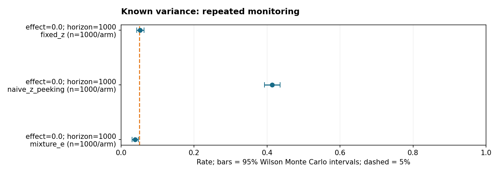
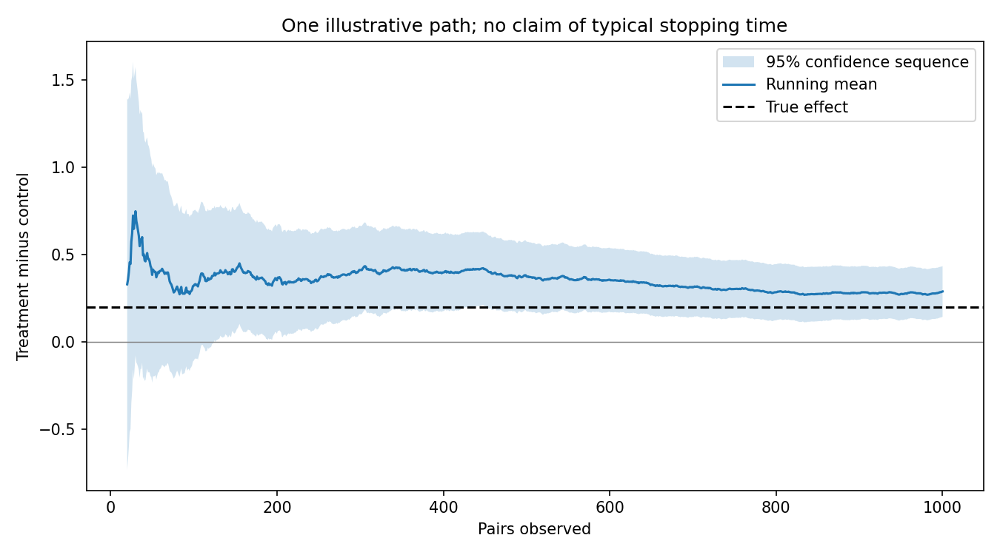

API: `experimentlab.sequential.normal_mixture`. Исследование:

```powershell
& $py -m experimentlab.sequential_study
# Быстрая проверка в отдельный каталог
& $py -m experimentlab.sequential_study --replications 100 --horizon 200 --output reports/sequential-quick
```

Формула смеси проверяется независимым численным интегрированием, а границы CS — подстановкой обратно в e-process. Метод не применяется автоматически к тяжёлохвостой выручке, неизвестной дисперсии, произвольным ratio-метрикам или кластерным данным.

Теоретический контекст: Howard, Ramdas, McAuliffe, Sekhon, [Time-uniform, nonparametric, nonasymptotic confidence sequences](https://arxiv.org/abs/1810.08240). Здесь реализован конкретный normal-mixture случай, а не весь набор методов статьи.

## Регрессионная корректировка и cross-fitting

Задача этого блока — использовать признаки, известные **до назначения варианта**, для уменьшения шума в оценке эффекта. Я сравниваю четыре заранее заданных метода на одних и тех же экспериментах. Модели прогнозируют исход, а основная цель исследования — качество оценки среднего эффекта, не точность прогноза сама по себе.

### Регрессия с взаимодействиями и HC3

Пусть $W_i\in\{0,1\}$ — назначенный вариант, $X_i$ — исходные признаки, $Z_i=X_i-\bar X$. В коде признаки также масштабируются для численной устойчивости. Используется полностью взаимодействующая регрессия:

$$Y_i=\beta_0+\tau W_i+\beta^\top Z_i+\gamma^\top(W_iZ_i)+\varepsilon_i.$$

Взаимодействия разрешают разные линейные зависимости в двух группах. Центрирование задаёт точку сравнения средних предсказаний: коэффициент $\widehat\tau$ соответствует контрасту при среднем наборе признаков. Это Lin-style корректировка; линейность условного среднего не требуется для её асимптотического обоснования при соответствующих условиях рандомизации.

Оценка минимизирует $\|Y-A\beta\|_2^2$, где $A=[1,W,Z,WZ]$. Вместо явного обращения $A^\top A$ реализация использует SVD. Коллинеарные признаки и нулевая остаточная степень свободы вызывают ошибку. При разных дисперсиях ошибок применяется HC3:

$$\widehat V_{HC3}=(A^\top A)^{-1}A^\top\operatorname{diag}\left(\frac{\widehat\varepsilon_i^2}{(1-h_{ii})^2}\right)A(A^\top A)^{-1}.$$

Здесь $h_{ii}$ — диагональ матрицы проекции, характеризующая leverage наблюдения. Стандартная ошибка эффекта — корень из соответствующего диагонального элемента ковариации. Интервал использует нормальный квантиль; HC3 не делает его точным в малой выборке. API возвращает число обусловленности, максимальный leverage и остаточные степени свободы. При leverage > 0,2 появляется предупреждение, при значении практически 1 расчёт прекращается.

Обоснование этой версии регрессионного интервала относится к эффекту для наблюдаемой выборки при условии её исходных признаков. При гетерогенных эффектах переход к эффекту в генеральной совокупности требует отдельного учёта вариации состава пользователей. Поэтому ниже используется **постоянный эффект**: оба целевых средних совпадают. Проверка не устанавливает покрытие для произвольной гетерогенности эффектов.

### AIPW с известной вероятностью назначения

Для независимой Bernoulli-рандомизации $P(W_i=1\mid X_i)=p$ вероятность $p$ известна из дизайна. Пусть $\widehat m_0(X)$ и $\widehat m_1(X)$ прогнозируют исход в контроле и тесте. Оценка строится из augmented inverse-probability weighted score:

$$\psi_i=\widehat m_1(X_i)-\widehat m_0(X_i)+\frac{W_i}{p}\{Y_i-\widehat m_1(X_i)\}-\frac{1-W_i}{1-p}\{Y_i-\widehat m_0(X_i)\},\qquad\widehat\tau=\frac1n\sum_i\psi_i.$$

Разность прогнозов дополняется взвешенной поправкой по остаткам. При известном корректном $p$ математическое ожидание score даёт средний эффект даже для неточных функций прогноза, если они обучены независимо от оцениваемого наблюдения. Ошибка в вероятности назначения нарушает это рассуждение. Нельзя подставлять долю тестовой группы, посчитанную из CSV, вместо вероятности, предусмотренной дизайном.

Ортогональность по функциям прогноза видна непосредственно:

$$E\left[1-\frac Wp\,\middle|\,X\right]=0,\qquad E\left[-1+\frac{1-W}{1-p}\,\middle|\,X\right]=0.$$

Это коэффициенты при возмущениях $m_1$ и $m_0$ в условном ожидании score. В этом конкретном случае с известным $p$ зависимость линейна и зануляется целиком. Полная задача DML с оцениванием propensity score и произведением ошибок двух nuisance-моделей здесь не реализована.

**Cross-fitting:** выборка делится на K частей без использования признаков, вариантов или исходов. Для каждой части модели двух исходов обучаются на остальных K−1 частях, отдельно по группам. Обученные модели строят два прогноза только для отложенных пользователей. Масштабирование Ridge также обучается внутри тренировочной части. Если в обучающей группе меньше трёх пользователей, алгоритм сообщает об ошибке и не подбирает другое разбиение.

Реализованы два заранее заданных семейства:

- **Ridge:** стандартизация признаков и L2-регуляризация с коэффициентом 1.
- **Random Forest:** 40 деревьев, максимальная глубина 6, минимум 8 наблюдений в листе, все признаки доступны при разбиении. В каждом запуске один вычислительный поток.

Гиперпараметры зафиксированы до полного прогона и не выбираются по его p-value или выигрышу в мощности. Показатель `observed_outcome_oof_rmse` оценивает качество прогноза фактически наблюдаемого исхода. Он не измеряет ошибку ненаблюдаемого индивидуального причинного эффекта.

Для AIPW используется асимптотическая стандартная ошибка:

$$\widehat{SE}=\frac{s_\psi}{\sqrt n},\qquad CI=\widehat\tau\pm z_{1-\alpha/2}\widehat{SE}.$$

Это требует регулярности и устойчивости обучения; cross-fitting сам по себе не даёт точного конечновыборочного покрытия. Обучающие части пересекаются, поэтому scores нельзя объявлять строго независимыми в конечной выборке. В проекте качество аппроксимации проверяется Monte Carlo.

### Модели и критерии сравнения

Исходные признаки независимы: $X_1,X_2,X_3\sim N(0,1)$; $W\sim Bernoulli(0.5)$ независимо от признаков. Исход:

$$Y=f(X)+\tau W+(0.75+0.35|X_1|)\varepsilon,\qquad\varepsilon\sim N(0,1).$$

| Механизм | Условное среднее без воздействия |
|---|---|
| Линейный | $f(X)=1.5X_1+X_2-0.5X_3$ |
| Нелинейный | $f(X)=2\sin(1.5X_1)+1.5(X_2^2-1)+0.75X_3$ |

В обеих моделях есть гетероскедастичность. Размеры **400 и 1 200 пользователей всего**, число в каждой группе случайно. Эффекты 0 и 0,25 измеряются в единицах исхода, а не в его стандартных отклонениях. В каждой из восьми ячеек — **200 независимых повторений**, seed **6036**, два фолда. Итого 1 600 наборов данных и 6 400 оценок. Ошибочные повторения не отбрасываются: исследование останавливается с ошибкой.

Для каждой ячейки сохраняются смещение, эмпирическое SD оценок, средняя стандартная ошибка, RMSE, средняя ширина интервала, покрытие и частота отклонения H₀. При $\tau=0$ последняя является ошибкой I рода, при $\tau\ne0$ — мощностью. Доли сопровождаются точечными 95%-ми интервалами Wilson; 200 повторений дают лишь ограниченную точность оценки редких ошибок.

$$\widehat{Bias}=\frac1R\sum_r(\widehat\tau_r-\tau),\qquad\widehat{RMSE}=\sqrt{\frac1R\sum_r(\widehat\tau_r-\tau)^2}.$$

Для сравнения MSE использую **парные** разности $d_r=(\widehat\tau_{adj,r}-\tau)^2-(\widehat\tau_{Welch,r}-\tau)^2$. Отрицательное среднее означает меньшую MSE корректировки. К среднему добавляется приближённый MC-интервал $\bar d\pm t_{0.975,R-1}s_d/\sqrt R$. Он учитывает общие данные методов; это интервал неопределённости симуляционного сравнения, а не интервал эффекта отдельного A/B-теста. Поправка на одновременный просмотр всех ячеек не применяется.

### Что получилось

При 1 200 пользователях всего и истинном эффекте 0,25:

| Метод | RMSE, линейная модель | Мощность, линейная | RMSE, нелинейная модель | Мощность, нелинейная |
|---|---:|---:|---:|---:|
| Welch | 0,1273 | 52,5% | 0,1539 | 32,0% |
| Lin / HC3 | 0,0637 | 98,0% | 0,1507 | 40,5% |
| AIPW / Ridge | 0,0643 | 98,0% | 0,1510 | 40,0% |
| AIPW / Random Forest | 0,0715 | 95,5% | 0,0878 | 75,0% |

В линейной модели регрессия и Ridge дали меньшую RMSE, чем лес с выбранными настройками. В нелинейной модели AIPW / Forest уменьшил RMSE относительно Welch примерно на **43%**, а мощность выросла с 32% до 75%. MC-интервалы мощности — **25,93–38,75%** и **68,57–80,49%** соответственно.

Парная разность MSE для AIPW / Forest против Welch в нелинейном сценарии равна **−0,01597**, приближённый 95% MC-интервал **[−0,01966; −0,01228]**. Для Lin / HC3 разность **−0,00096**, интервал **[−0,00406; 0,00214]**: этот прогон не позволяет уверенно установить снижение MSE линейной корректировки в данной ячейке. Все значения относятся к выбранным моделям данных и настройкам обучения.

Мощность нужно рассматривать вместе с калибровкой. В отдельных A/A-сценариях при том же размере 1 200:

| Метод | Ошибка I рода, линейная модель; 95% MC-интервал | Ошибка I рода, нелинейная модель; 95% MC-интервал |
|---|---:|---:|
| Welch | 6,0%; 3,47–10,19% | 7,0%; 4,22–11,41% |
| Lin / HC3 | 2,5%; 1,07–5,72% | 7,0%; 4,22–11,41% |
| AIPW / Ridge | 1,5%; 0,51–4,32% | 7,5%; 4,60–12,00% |
| AIPW / Random Forest | 3,5%; 1,71–7,05% | 6,0%; 3,47–10,19% |

При 200 повторениях интервалы широкие. Ridge в линейной нулевой ячейке получился консервативным; значения 6–7,5% в нелинейной ячейке совместимы с 5% в пределах этой точечной MC-погрешности. Поэтому я не трактую исследование как доказательство точного уровня каждого ML-теста. При ненулевом эффекте в нелинейной модели покрытие AIPW / Forest — **95,5%** (91,67–97,61%). Полное покрытие всех ячеек приведено ниже и в CSV.

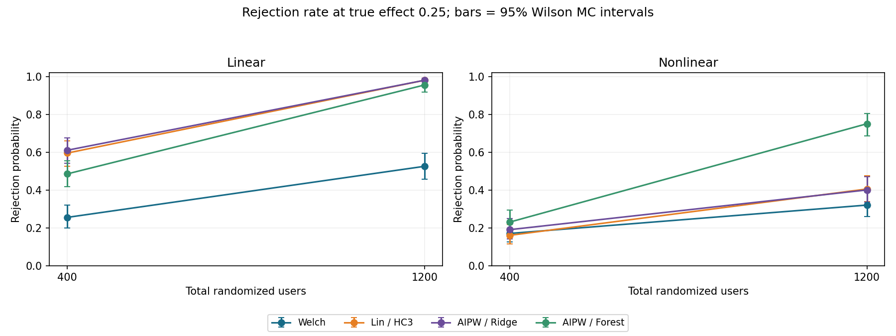
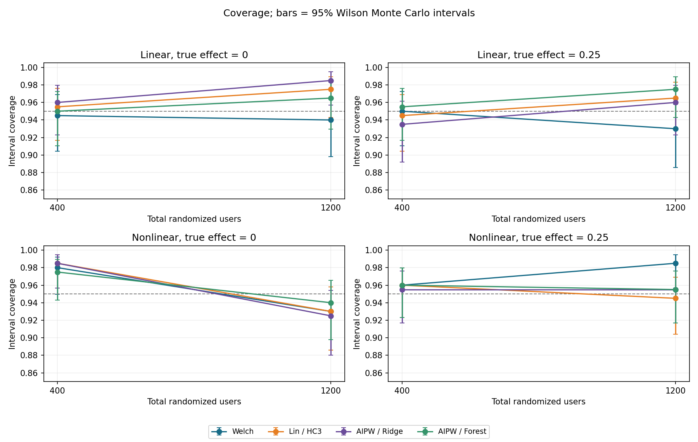
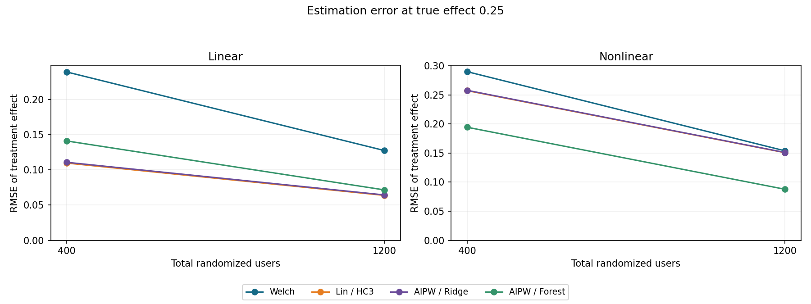
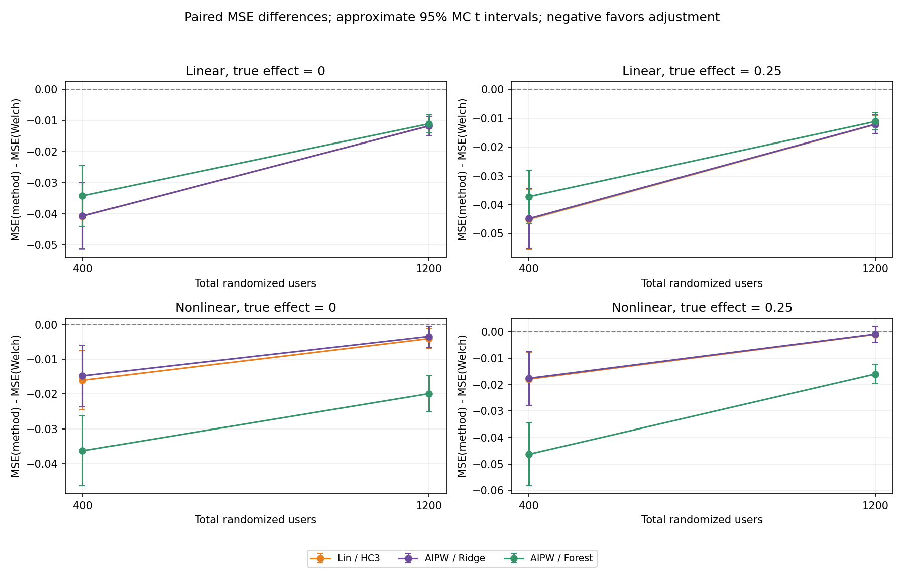
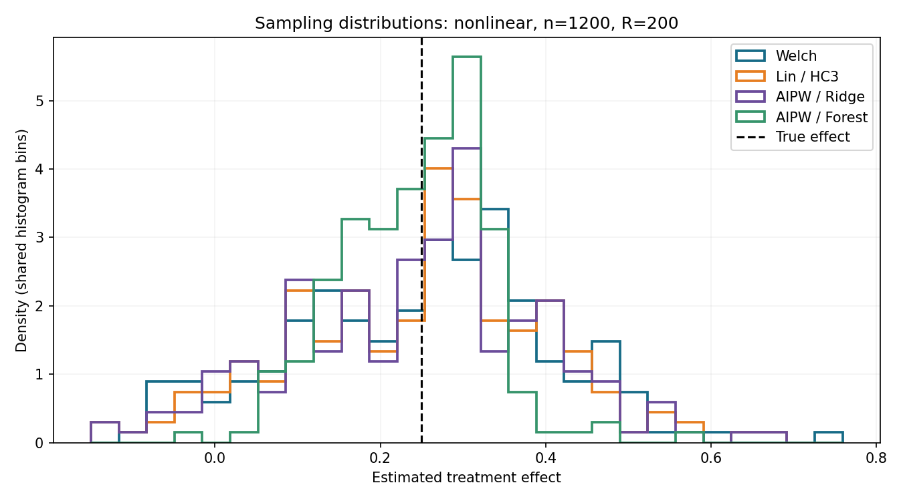

Полные результаты: [summary.csv](reports/adjustment/summary.csv), [paired_comparisons.csv](reports/adjustment/paired_comparisons.csv), [все отдельные оценки и seed](reports/adjustment/replications.csv). Параметры и контрольные суммы записаны в [manifest.json](reports/adjustment/manifest.json).

### Воспроизведение и собственный CSV

```powershell
# Короткая проверка: 10 повторений на ячейку; не для устойчивых выводов
& $py -m experimentlab.adjustment_study --config configs/adjustment_quick.json --output reports/adjustment-quick

# Полный расчёт таблиц и пяти графиков
& $py -m experimentlab.adjustment_study --config configs/adjustment_full.json --output reports/adjustment

# Демонстрационные синтетические данные с исходными признаками
& $py -m experimentlab.adjustment demo --n 800 --seed 42 --output local_data/covariates.csv

# Сравнить четыре метода; основную процедуру нужно выбрать до просмотра результатов
& $py -m experimentlab.adjustment analyze local_data/covariates.csv --metric outcome --covariates x1 x2 x3 --propensity 0.5 --output local_data/adjustment

# Только заранее выбранный AIPW / Random Forest и контрольный Welch
& $py -m experimentlab.adjustment analyze local_data/covariates.csv --metric outcome --covariates x1 x2 x3 --method aipw --learner forest --propensity 0.5 --output local_data/adjustment-forest
```

CSV содержит уникальный `user_id`, `group` со значениями `control`/`treatment`, числовую метрику и перечисленные числовые признаки. Пропуски и бесконечности не удаляются автоматически. Нельзя включить ID, группу или саму метрику в список ковариат; факт измерения **до воздействия** остаётся ответственностью автора анализа. Корректировка послеэкспериментальными признаками может исказить эффект.

В каталоге результата появляются `summary.json`, таблица средних и стандартизованных различий `balance.csv`, а для AIPW — отдельные `*_oof.csv` с двумя прогнозами, фолдом и score на каждого пользователя. Эти строки относятся к пользовательским данным и по умолчанию сохраняются в исключённом из Git каталоге `local_data/`. SRM проверяет соотношение групп относительно заданного `--propensity`; это диагностический сигнал, не подтверждение всех предпосылок. Выбор минимального p-value среди четырёх методов не является заявленной процедурой с уровнем 5%.

Теоретическая основа: [Lin (2013)](https://arxiv.org/abs/1208.2301), [Chernozhukov et al., Double/Debiased Machine Learning](https://arxiv.org/abs/1608.00060); эталон ковариации — [statsmodels HC3](https://www.statsmodels.org/stable/generated/statsmodels.regression.linear_model.OLSResults.HC3_se.html).


## Слабый знаменатель: доверительные множества Филлера

В этом исследовании я изучаю ситуацию, в которой деление на оценённое среднее становится нестабильным. Цель — одно отношение $r=E[X]/E[Y]$, где $E[Y]\ne0$, по независимым парам $(X_i,Y_i)$. Это не среднее индивидуальных отношений и не разность двух ratio-метрик.

### Обращение теста вместо линеаризации

При независимых одинаково распределённых невырожденных двумерно-нормальных наблюдениях для истинного отношения:

$$T(r)=\frac{\bar X-r\bar Y}{\sqrt{(s_X^2-2rs_{XY}+r^2s_Y^2)/n}}\sim t_{n-1}.$$

Поэтому множество всех неотклонённых значений $r$ обладает точным покрытием $1-\alpha$ в этой модели. Обозначим $v_X=s_X^2/n$, $v_Y=s_Y^2/n$, $c=s_{XY}/n$ и $q=t_{1-\alpha/2,n-1}^2$. Возведение неравенства $|T(r)|\le\sqrt q$ в квадрат даёт:

$$Ar^2+Br+C\le0,$$

$$A=\bar Y^2-qv_Y,\quad B=-2(\bar X\bar Y-qc),\quad C=\bar X^2-qv_X.$$

В `fieller.py` решается это квадратное неравенство, включая линейные и вырожденные случаи. Корни вычисляются с уменьшением потери точности от вычитания близких чисел.

| Геометрия | Смысл результата |
|---|---|
| Ограниченный интервал | Знаменатель достаточно отделён от нуля |
| Два неограниченных луча | Исключается центральная область, но произвольно большие отношения остаются допустимыми |
| Вся числовая прямая | Данные не позволяют исключить ни одного конечного отношения |
| Полупрямая | Граничный случай линейного неравенства |

Общий решатель также поддерживает пустое множество и точку. Для невырожденной нормальной выборки обычные результаты Филлера имеют первые три формы. Неограниченность не заменяется искусственно большим числом и не считается ошибкой алгоритма. В JSON бесконечные границы кодируются `null`, тип множества сохраняется отдельно.

### Почему delta method может вводить в заблуждение

Для $g(a,b)=a/b$ градиент равен $(1/b,-a/b^2)$. Линеаризация даёт:

$$\widehat{Var}(\widehat r)\approx\frac{v_X-2\widehat r c+\widehat r^2v_Y}{\bar Y^2}.$$

При приближении знаменателя к нулю производные растут, а локальная линейная аппроксимация становится ненадёжной. Филлер сохраняет нелинейную геометрию обращения теста. Для ненормальных данных точная t-гарантия перестаёт действовать: необходимы дополнительные асимптотические условия и проверки. Модель здесь допускает отрицательные значения; это исследование оценивания, а не модель положительной выручки.

### Воспроизводимый эксперимент

Девять сценариев: n = 30, 100, 500; среднее знаменателя 0,05, 0,2, 1. Истинное отношение всегда 2, дисперсии обоих исходов 1, корреляция 0,5. По 2 000 повторений на сценарий, всего 18 000 независимых выборок. Оба метода применяются к одним парам. Отчёт содержит покрытие и частоту неограниченных множеств с точечными Wilson-интервалами; отдельный тест разности покрытий не проводится.

При n=30 и среднем знаменателя 0,05 покрытие delta-интервала составило **79,50%**, Филлера — **96,15%**. В **94,60%** повторений множество Филлера было неограниченным: высокая неопределённость знаменателя не позволяет получить содержательный ограниченный интервал. Это результат данной нормальной модели; отдельные MC-интервалы приведены в CSV.

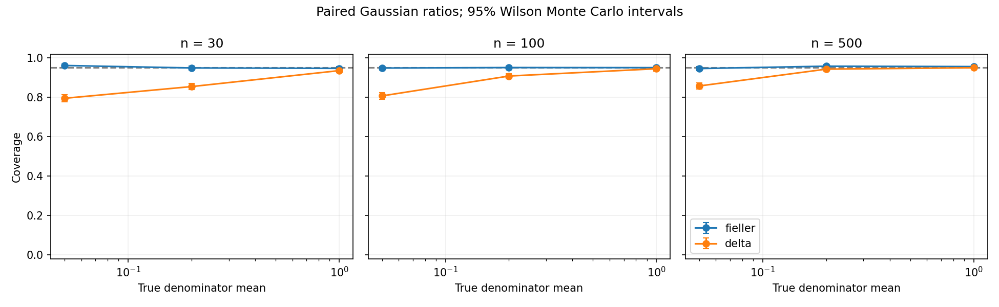
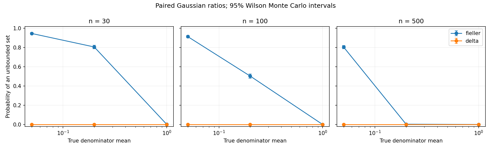

Полные результаты: [summary.csv](reports/fieller/summary.csv), [replications.csv](reports/fieller/replications.csv). Запуск:

```powershell
& $py -m experimentlab.fieller_study
& $py -m experimentlab.fieller_study --replications 100 --output reports/fieller-quick
```

Python API:

```python
from experimentlab.fieller import fieller
result = fieller(numerator, denominator)
print(result.kind, result.intervals)
print(result.contains(2.0))
print(result.to_dict())
```

Тесты сверяют принадлежность сотен точек полученному множеству с независимым вызовом `scipy.stats.ttest_1samp(X-r*Y, 0)`. Дополнительно проверяются геометрические случаи и инвариантность к совместной смене масштаба исходов.

Источник: von Luxburg, Franz, [A Geometric Approach to Confidence Sets for Ratios](https://arxiv.org/abs/0711.0198). Реализован классический нормальный случай, без bootstrap-обобщений статьи.


## Чувствительность к форме распределения

Я дополнительно проверяю ratio-методы вне точной нормальной модели. У всех сценариев одинаковы первые два момента: средние числителя и знаменателя 0,4 и 0,2, дисперсии 1, ковариация 0,5. Истинное отношение равно 2. Меняется форма распределения исходных независимых компонент U и V:

$$X=0.4+U,\qquad Y=0.2+0.5U+\sqrt{0.75}V.$$

| Компоненты | Нормировка и свойства |
|---|---|
| Нормальные | U, V независимо N(0,1) |
| Логнормальные | $(\exp Z-\exp(1/2))/\sqrt{e(e-1)}$, Z ~ N(0,1); асимметрия, все моменты конечны |
| Student t₃ | t₃ / √3; дисперсия конечна, четвёртый момент бесконечен |

Из независимости компонент непосредственно следуют Var(X)=Var(Y)=1 и Cov(X,Y)=0,5. Таким образом, различия результатов нельзя объяснить изменением этих популяционных моментов. Это синтетические центрированные метрики, допускающие отрицательные значения.

Для ненормальных моделей точное t-распределение статистики Филлера отсутствует. Конечная дисперсия позволяет применять центральную предельную теорему к средним при увеличении n, но не гарантирует хорошего покрытия при конкретном размере выборки. В частности, отсутствие четвёртого момента у t₃ делает поведение выборочной дисперсии менее устойчивым. Этот эксперимент проверяет конечновыборочное поведение, а не устанавливает универсальную скорость сходимости.

Размеры n=100 и 500, три модели, по 1 000 независимых повторений: **6 000 дополнительных выборок**, seed 1955. Для каждого метода сохраняются покрытие и частота неограниченных множеств с точечными Wilson-интервалами.

Для парного сравнения покрытия используется $D_r=I\{2\in C_{F,r}\}-I\{2\in C_{D,r}\}$. Среднее D оценивает разность покрытий Филлера и delta method; приближённый 95% MC-интервал равен $\bar D\pm t_{0.975,R-1}s_D/\sqrt R$. Эта процедура учитывает общие выборки методов. Она не является точным тестом и не корректирует одновременный просмотр нескольких сценариев.

При логнормальных компонентах и n=100 покрытие Филлера составило **90,6%** (95% MC-интервал 88,63–92,26%), delta method — **92,8%** (91,03–94,24%). При n=500 — 93,2% и 95,4% соответственно. Этот сценарий показывает нарушение номинального покрытия вне нормальной модели; выбирать метод только по результатам одной симуляции нельзя.

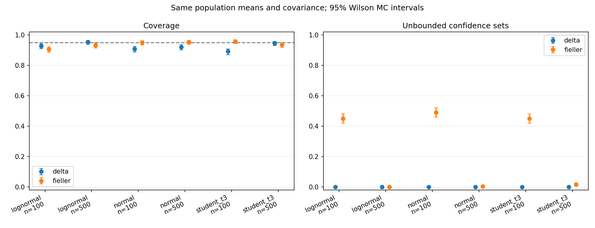

Таблицы: [summary.csv](reports/ratio_sensitivity/summary.csv), [парные разности покрытия](reports/ratio_sensitivity/paired_coverage.csv), [все повторения](reports/ratio_sensitivity/replications.csv).

```powershell
& $py -m experimentlab.ratio_sensitivity
& $py -m experimentlab.ratio_sensitivity --replications 100 --output reports/ratio-sensitivity-quick
```

Реализация: `experimentlab/ratio_sensitivity.py`; проверки генератора: `tests/test_ratio_sensitivity.py`. Прогон прекращается при ошибке оценивания; повторения не отбрасываются и не заменяются.

## Методика

### Область применения

Две независимые рандомизированные группы, одна строка на пользователя, заранее выбранная метрика и горизонт эксперимента. Эффект везде определяется как **treatment − control**. Проверки двусторонние. Основной CLI не принимает решения «выкатывать/не выкатывать»: статистическая значимость сама по себе не определяет бизнес-полезность.

### Средние: Welch

Для выборочных средних и дисперсий:

$$
\widehat\Delta=\bar Y_T-\bar Y_C,\qquad
SE=\sqrt{\frac{s_T^2}{n_T}+\frac{s_C^2}{n_C}}.
$$

Степени свободы рассчитываются по Welch–Satterthwaite:

$$
\nu=\frac{(s_T^2/n_T+s_C^2/n_C)^2}{(s_T^2/n_T)^2/(n_T-1)+(s_C^2/n_C)^2/(n_C-1)}.
$$

Интервал: $\widehat\Delta\pm t_{1-\alpha/2,\nu}SE$. Реализация сверяется с `scipy.stats.ttest_ind(equal_var=False)`, включая границы интервала.

### Конверсия

Pooled z-test использует общую оценку вероятности при H₀. Для разности долей строится интервал Newcombe на основе двух интервалов Wilson. Он устойчивее простого Wald-интервала у границ 0 и 1, но **не является обращением используемого z-теста**. Поэтому решения интервала и p-value около порога могут различаться.

При малых ожидаемых частотах возвращается предупреждение о ненадёжности нормальной аппроксимации. При полностью одинаковых нулевых или единичных исходах p-value принят равным 1; интервал остаётся ненулевой ширины. Для непрерывных констант с нулевой стандартной ошибкой Welch явно сообщает, что оценивание невозможно.

### Bootstrap и перестановочный тест

Bootstrap независимо пересэмплирует пользователей внутри каждой группы. Используется percentile-интервал разности средних; p-value из него не восстанавливается. Расчёт разбит на батчи, чтобы ограничить потребление памяти.

Перестановочный тест реализован через SciPy и включается в CLI отдельным флагом. Его условие — обменность наблюдений при H₀: одинаковые распределения или соответствующая строгая рандомизационная нулевая гипотеза. Равенства средних при произвольно разных дисперсиях недостаточно. При случайных перестановках SciPy применяет поправку, исключающую нулевой p-value; при малом числе разбиений выполняется точный перебор.

### CUPED

$$
Y_{adj}=Y-\theta(X-\mu_X),\qquad
\theta^*=\frac{\operatorname{Cov}(X,Y)}{\operatorname{Var}(X)}.
$$

При оптимальном коэффициенте дисперсия равна $\operatorname{Var}(Y)(1-\rho^2)$. В стандартизованной линейной модели с фиксированным оценённым коэффициентом отношение дисперсий равно $1+\widehat\theta^2-2\widehat\theta\rho$.

В проекте `Cuped.fit` вызывается на независимой исторической выборке. Для обеих экспериментальных групп используется один коэффициент и один исторический центр. В каждой серии ρ историческая модель фиксирована; частоты и покрытие оцениваются **условно на этой калибровке**, а не по множеству переобучений. API не может проверить происхождение переданных массивов — отсутствие утечки обеспечивает вызывающая сторона.

### Модели данных и погрешность Monte Carlo

| Модель | Генерация и смысл |
|---|---|
| normal | N(0,1) |
| lognormal | LogNormal(0,1), центрирование и деление на истинное стандартное отклонение |
| zero_inflated | Bernoulli(0,2) × Exponential(1), затем центрирование и нормировка |
| student_t3 | t с 3 степенями свободы, делённое на √3; дисперсия конечна, четвёртый момент нет |
| conversion | Bernoulli(0,10) в контроле; 0,10 или 0,12 в тесте |
| CUPED | X ~ N(0,1), Y = ρX + √(1−ρ²)ε + эффект |

У непрерывных моделей среднее 0 и дисперсия 1 до добавления эффекта. После центрирования значения могут быть отрицательными: это исследование формы распределения стандартизованной метрики, а не модель фактических цен. Отдельный `demo` генерирует неотрицательную синтетическую выручку.

Для события E оценивается $\widehat p=K/R$, где R — число независимых повторений. Ошибка I рода — доля отклонений при нулевом эффекте, мощность — при ненулевом, покрытие — доля интервалов, содержащих истинный эффект. К каждой доле добавлен 95%-й Wilson-интервал. Интервалы точечные, не одновременные; методы на общей выборке зависимы, и разность их частот нельзя оценивать как разность независимых долей.

Потоки случайных чисел пяти исследовательских блоков разделены через `SeedSequence.spawn`. Фиксированные seed и версии зависимостей позволяют повторить расчёты; идентичность PNG в байтах между ОС не обещается.

## Структура

| Путь | Назначение |
|---|---|
| `experimentlab/inference.py` | Welch, разность конверсий, Wilson-интервалы |
| `experimentlab/planning.py` | Мощность, размер выборки, MDE |
| `experimentlab/resampling.py` | Bootstrap и перестановочный тест |
| `experimentlab/cuped.py` | Калибровка и применение CUPED |
| `experimentlab/multiplicity.py` | Holm и Bonferroni |
| `experimentlab/data.py` | Синтетические модели, валидация пользовательских данных, SRM |
| `experimentlab/studies.py` | Исследовательские сценарии Monte Carlo |
| `experimentlab/reporting.py` | Общий вывод CSV/JSON, базовые графики, контрольные суммы |
| `experimentlab/ratio.py`, `clusters.py`, `advanced_resampling.py` | Ratio, кластерные средние и BCa |
| `experimentlab/robustness.py`, `advanced.py` | Исследование устойчивости и отдельный CLI |
| `experimentlab/sequential.py`, `sequential_study.py` | E-process, доверительная последовательность и симуляции |
| `experimentlab/regression.py` | SVD-решение OLS, робастная ковариация HC3, Lin-style корректировка |
| `experimentlab/crossfit.py` | Cross-fitted AIPW с Ridge или Random Forest, аудит фолдов |
| `experimentlab/adjustment_data.py`, `adjustment.py` | Генератор эксперимента с признаками и CSV-интерфейс |
| `experimentlab/evaluation.py`, `adjustment_study.py` | Метрики оценивания, парные сравнения, пять графиков ML-блока |
| `experimentlab/config.py`, `validation.py` | Проверки параметров |
| `experimentlab/cli.py` | Командная строка |
| `configs/` | Быстрый и полный прогоны базового и ML-исследований |
| `reports/` | Шесть серий результатов, 19 графиков, параметры и контрольные суммы |
| `tests/` | Эталонные, граничные, статистические и сквозные проверки |
| `notebooks/quickstart.ipynb` | Небольшой пример API с выводом |
| `scripts/execute_demo.py` | Последовательное выполнение Python-ячеек примера |
| `.github/workflows/tests.yml` | CI для Windows/Linux и Python 3.11/3.12 |

Вся вычислительная логика находится в `.py`. Notebook демонстрирует API и не содержит отдельной реализации методов. Статистика языков GitHub специально не переопределяется.

В каждом `manifest.json` поле `artifact_sha256` относится к файлам соответствующего расчёта, а `source_sha256` — к снимку кода в момент его формирования. Сохранённые результаты предыдущих серий не перегенерируются при каждом расширении пакета; их исторические хеши исходников не обязаны совпадать с текущей версией. Версии зависимостей и параметры каждого прогона указаны отдельно. Текущие проверки выпуска записаны в [validation.json](reports/validation.json).


## Источники

- [SciPy: Welch t-test](https://docs.scipy.org/doc/scipy/reference/generated/scipy.stats.ttest_ind.html).
- [SciPy: bootstrap](https://docs.scipy.org/doc/scipy/reference/generated/scipy.stats.bootstrap.html) и [permutation_test](https://docs.scipy.org/doc/scipy/reference/generated/scipy.stats.permutation_test.html).
- [statsmodels: TTestIndPower](https://www.statsmodels.org/stable/generated/statsmodels.stats.power.TTestIndPower.html), [proportions_ztest](https://www.statsmodels.org/stable/generated/statsmodels.stats.proportion.proportions_ztest.html) и [интервалы разности долей](https://www.statsmodels.org/stable/generated/statsmodels.stats.proportion.confint_proportions_2indep.html).
- Deng, Xu, Kohavi, Walker (2013). [Improving the Sensitivity of Online Controlled Experiments by Utilizing Pre-Experiment Data](https://exp-platform.com/cuped/). CUPED, DOI: 10.1145/2433396.2433413.
- Lin (2013). [Agnostic notes on regression adjustments to experimental data: Reexamining Freedman's critique](https://arxiv.org/abs/1208.2301).
- Chernozhukov et al. [Double/Debiased Machine Learning for Treatment and Structural Parameters](https://arxiv.org/abs/1608.00060). Основа обсуждения ортогональных scores и cross-fitting; проект реализует только вариант с известной рандомизацией.
- [statsmodels: HC3](https://www.statsmodels.org/stable/generated/statsmodels.regression.linear_model.OLSResults.HC3_se.html); [scikit-learn: RandomForestRegressor](https://scikit-learn.org/stable/modules/generated/sklearn.ensemble.RandomForestRegressor.html).

Код, документация и собственные синтетические результаты — [MIT](LICENSE). Данные внешних компаний в репозитории не распространяются.
